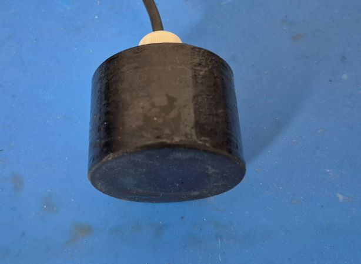
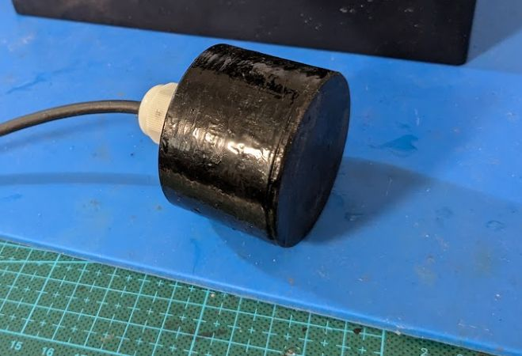
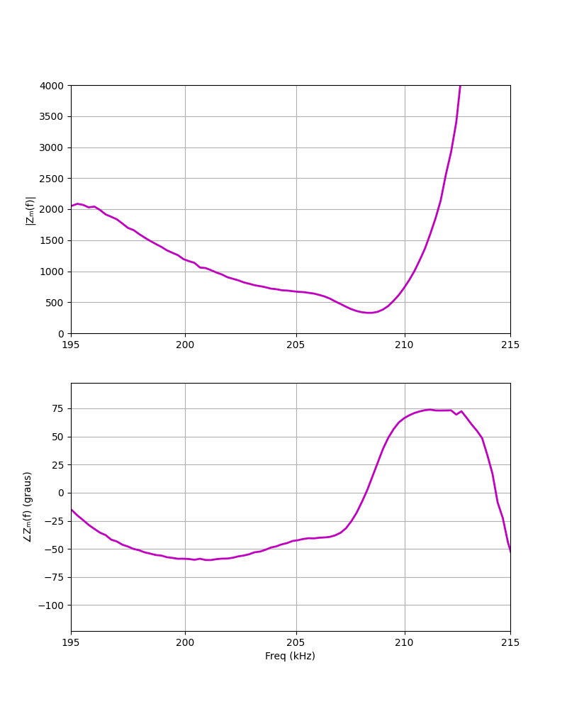
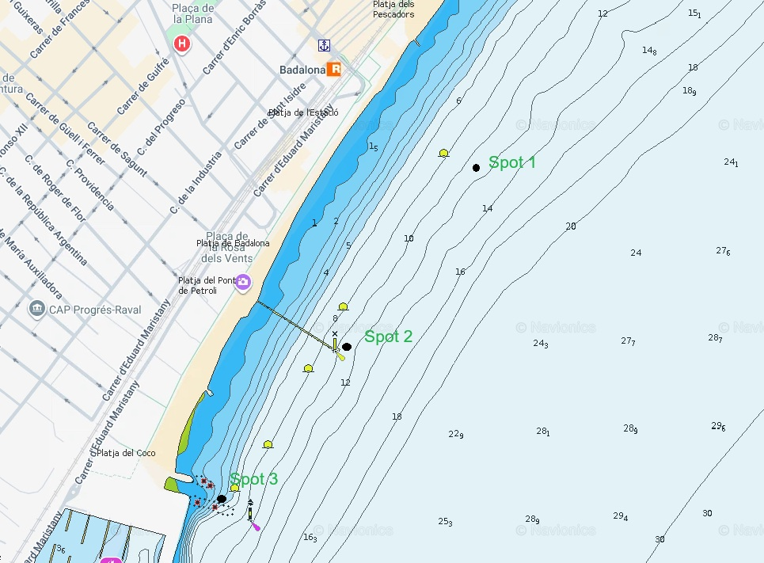
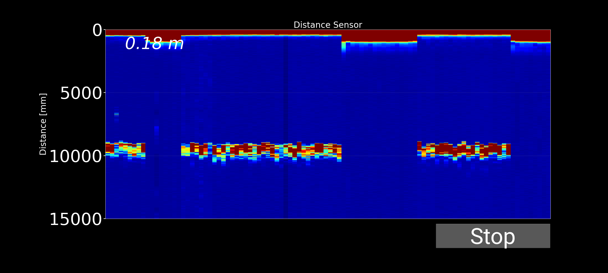
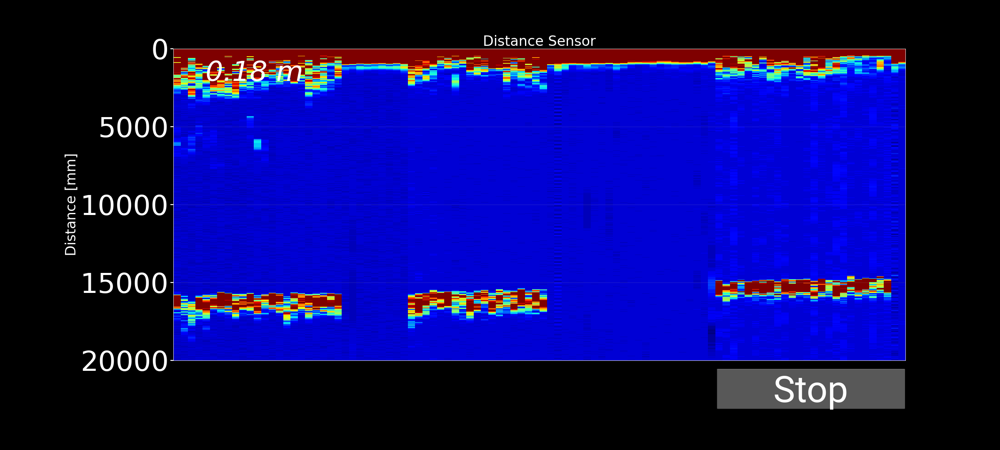
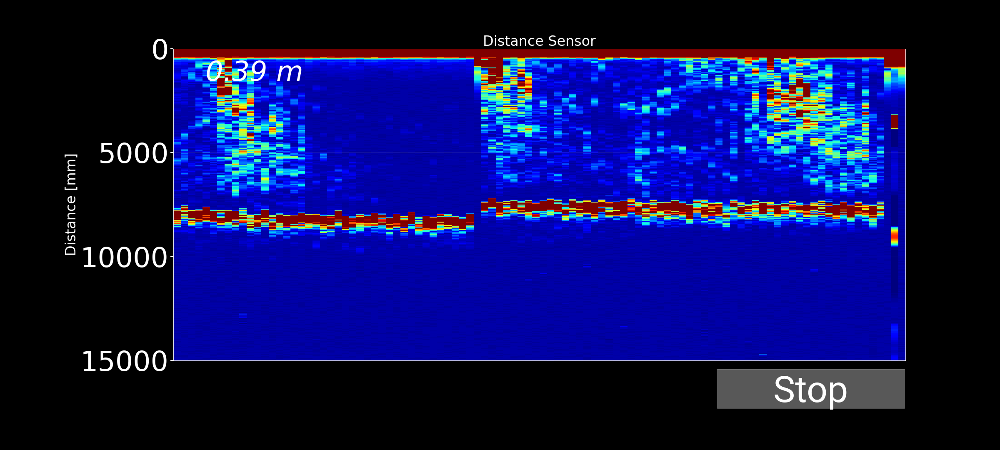
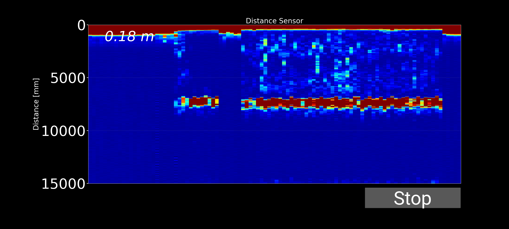
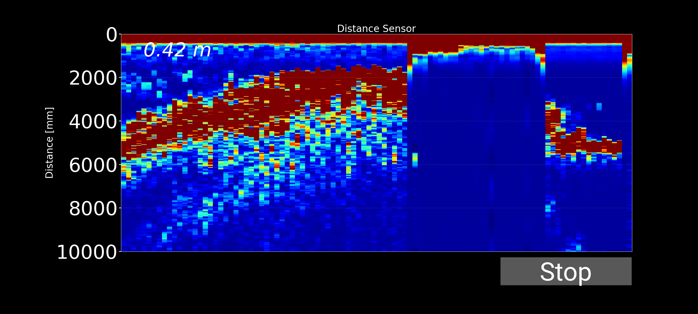

[Español]()

## Introduction

After some time away from this project, and based on the experience gained during previous developments, I decided to design a new 200 kHz transducer. For its construction, I used a piezoelectric disc with a diameter of 38 mm and a thickness of 10 mm.

The objective was to evaluate the performance of this new transducer under real operating conditions. To achieve this, tests were carried out at three different locations with different seabed characteristics. This made it possible to analyze the behavior of both the transducer and the complete system, including the acquisition electronics and the Android application developed for visualization and processing of the acquired data.

**Let's get started!**

### 200 kHz Transducer

The transducer was designed around a PZT piezoelectric element measuring 38 mm in diameter and 10 mm in thickness. This disc exhibits a resonance frequency close to 200 kHz in its thickness vibration mode, making it suitable for echo sounding and depth measurement applications.

The transducer housing was manufactured using 3D-printed PETG and subsequently encapsulated with epoxy resin to ensure waterproofing and resistance to the marine environment.

Particular attention was paid to the acoustic matching layer and backing layer during the design process. Their properties were adjusted to optimize acoustic energy transmission into the water and improve the transducer's temporal response.

{:style="text-align:center;"}
{: .half}
{: .half}

To evaluate its performance, the frequency response was measured using a NanoVNA. The resulting graph shows a resonance frequency around 210 kHz, very close to the value predicted during the design phase. This small difference is perfectly normal and can be attributed to tolerances in the piezoelectric material, acoustic matching layers, and transducer assembly process.

{:style="text-align:center;"}

## Sea Trial Design

To evaluate the transducer's performance, it was necessary to test it over different seabed types. Although sandy bottom predominates in my local area, several underwater structures are available that allow the system's behavior to be evaluated in different scenarios.

Testing was therefore conducted at three different locations, shown on the nautical chart included in this article.

{:style="text-align:center;"}

### Test Location 1 - Sandy Bottom

A sandy seabed at a depth between 10 and 15 meters. This location allows evaluation of bottom detection performance under relatively homogeneous conditions with few structures capable of generating secondary echoes..

### Test Location 2 - Artificial Structure

Remains of an old pier located over a sandy bottom, with a depth of approximately 5 to 10 meters. Medium-sized schools of fish, mainly mullet, are commonly found in this area, making it a suitable location for evaluating the detection of targets suspended in the water column.



### Test Location 3 - Rocky Breakwater

A shallow breakwater with depths ranging from 0 to 5 meters. This area contains numerous rocky structures where small schools of fish, as well as species such as seabream and damselfish, can often be found. This location allows analysis of system performance in environments with multiple reflections and bottom-generated echoes.



## Sea Trial Video

As has become customary in this project, a kayak was used to reach the different test locations. Although it is not the most comfortable platform for this type of work, it is practical and sufficient for validating the system under real conditions.

The trial video demonstrates both the operation of the equipment and the results obtained during the testing session.



## Results - Location 1: Sandy Bottom (12-15 m)

At this location, the system provides a stable and clearly defined bottom return at the expected depth. No significant echoes are visible between the surface and the seabed, indicating the absence of fish or other suspended targets. The result is consistent with a clean sandy seabed and represents a typical sonar image for this type of environment.

{:style="text-align:center;"}

{:style="text-align:center;"}

## Results - Location 2: Artificial Structure

Beneath the remains of the old pier, the recorded image is similar to the previous case because the bottom is still sandy. However, several echoes appear at intermediate depths, corresponding to fish suspended between the supporting pillars. These returns clearly reveal the presence of marine life, while the bottom line remains well defined.

{:style="text-align:center;"}

{:style="text-align:center;"}

##  Results - Location 3: Shallow Breakwater

In the shallow breakwater area, the bottom line appears thicker and more irregular than in the previous cases. This effect is produced by the multiple echoes generated by the rocks forming the structure, together with small fish suspended nearby. As a result, the bottom representation appears more diffuse and contains a greater echo dispersion.

{:style="text-align:center;"}

## Conclusions and Future Improvements

The tests demonstrate that the system is capable of correctly detecting the seabed and distinguishing between different underwater environments. Sandy bottoms produce a clean and well-defined representation, whereas areas containing structures such as piers and breakwaters generate additional echoes associated with fish and surrounding objects.

Furthermore, the developed transducer behaved as expected, exhibiting a resonance frequency close to 210 kHz. Overall, the results validate both the transducer design and the echo sounder itself, confirming its ability to measure depth and detect targets suspended within the water column.

However, the tests also revealed several areas for improvement:

- Improve depth measurement accuracy.
- Adjust the number of pulses in each ultrasonic burst according to depth in order to obtain a proper bottom representation and a consistent bottom-line thickness.
- Define the most appropriate sampling frequency so that the acquisition time window covers the desired maximum depth.
- Implement **TVG (Time Variable Gain)** to compensate for acoustic signal attenuation with distance and maintain similar echo intensity at different depths.
- Improve temporal resolution by increasing the number of pings per second, resulting in a smoother sonar image and reducing its pixelated appearance.

These improvements will be implemented in the next version of the software.