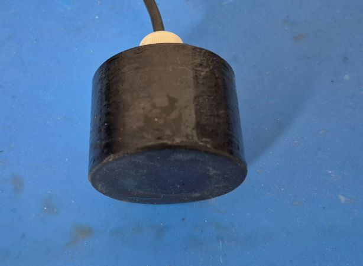
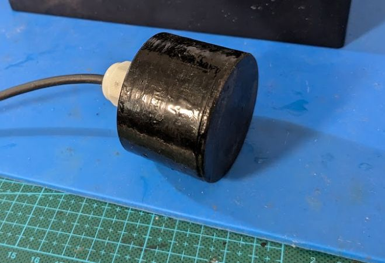
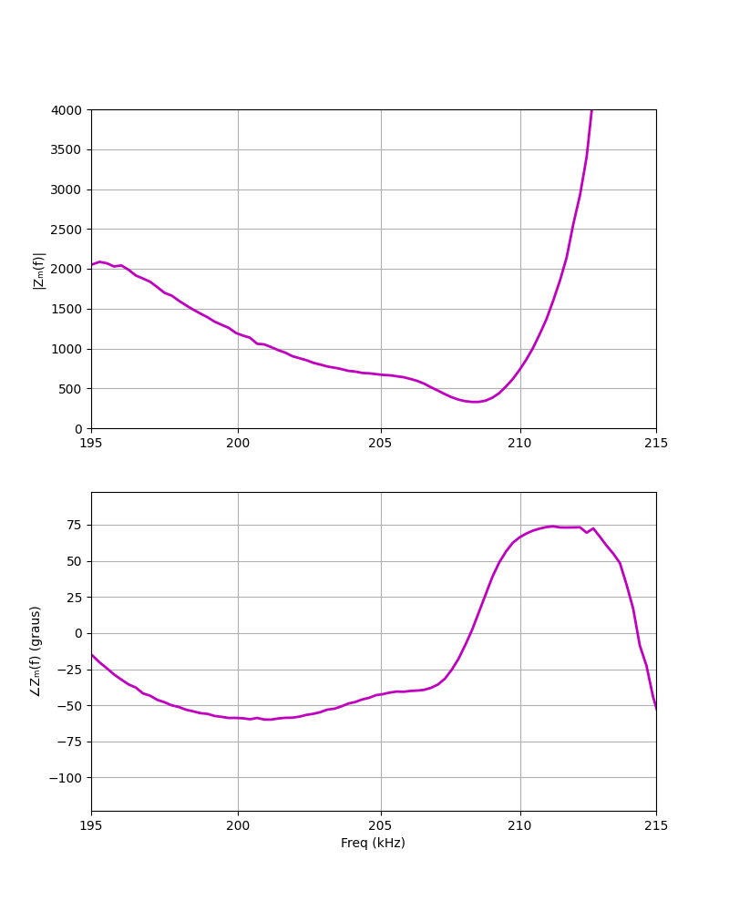
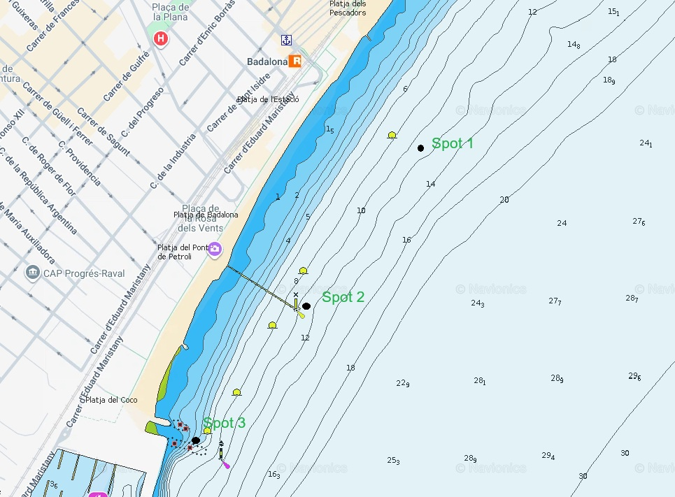
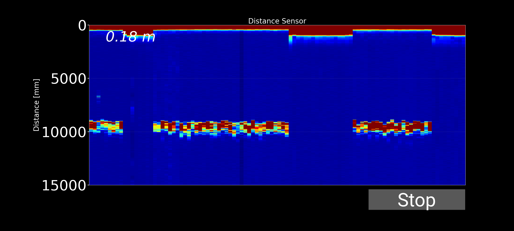
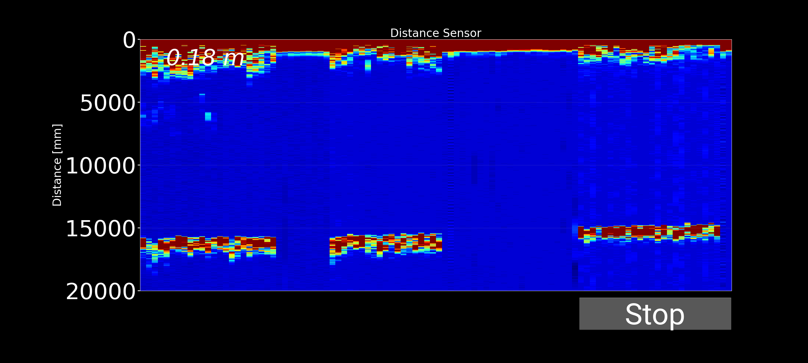
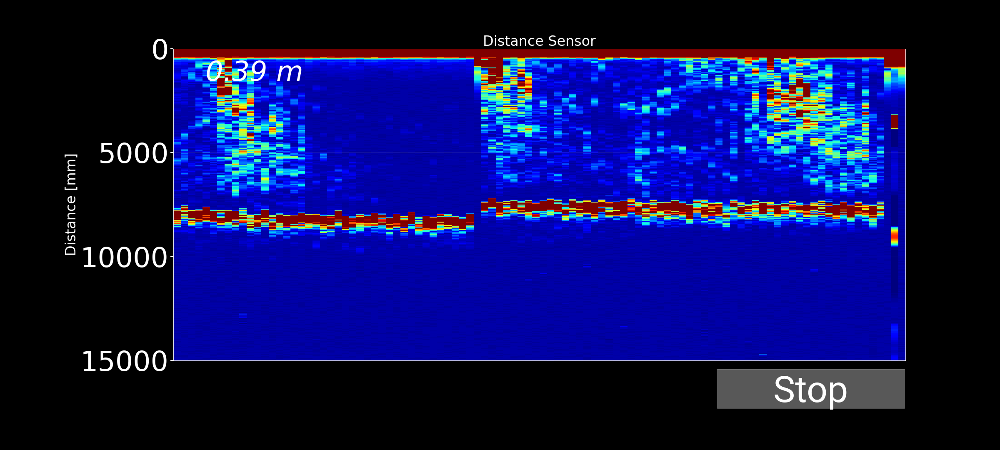
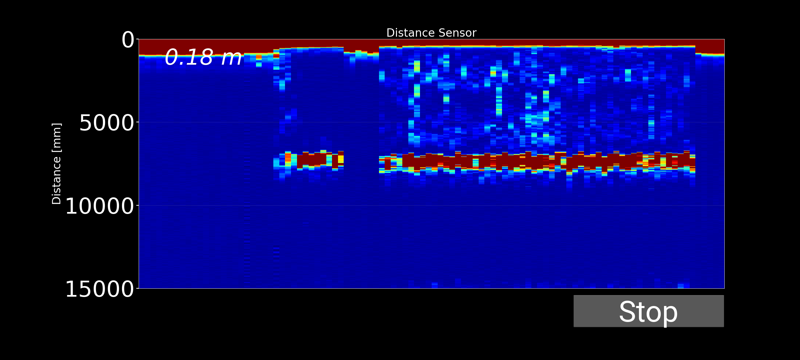
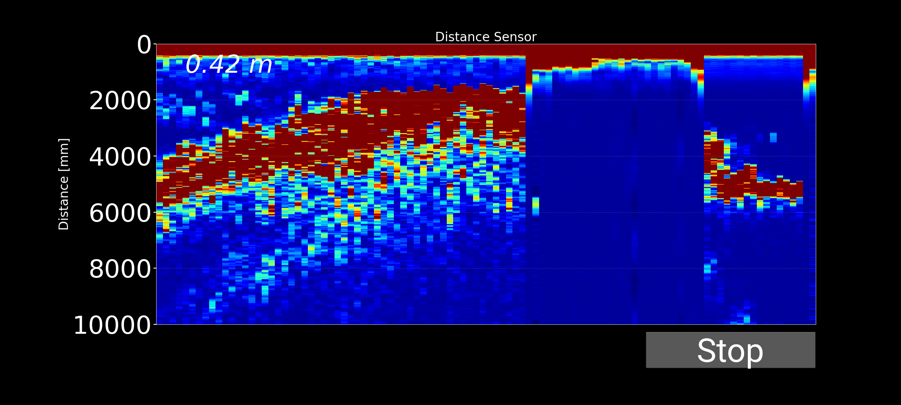

[English]()

## Introducción

Después de un tiempo sin trabajar en este proyecto, y basándome en la experiencia adquirida durante los últimos desarrollos, me he animado a diseñar un nuevo transductor de 200 kHz. Para su construcción he utilizado un disco piezoeléctrico de 38 mm de diámetro y 10 mm de espesor.

El objetivo es evaluar el rendimiento de este nuevo transductor en condiciones reales. Para ello, realizaré pruebas en tres ubicaciones con diferentes tipos de fondo marino, lo que permitirá analizar el comportamiento tanto del transductor como del sistema completo, incluyendo la electrónica de adquisición y la aplicación Android desarrollada para la visualización y procesamiento de los datos obtenidos.

!!! Vamos a ello !!!

## Transductor de 200 kHz

El transductor se ha diseñado a partir de un elemento piezoeléctrico de PZT con unas dimensiones de 38 mm de diámetro y 10 mm de espesor. Este disco presenta una frecuencia de resonancia cercana a los 200 kHz en su modo de vibración por espesor, lo que lo hace adecuado para aplicaciones de ecosonda y medida de profundidad.

La carcasa del transductor se ha fabricado mediante impresión 3D utilizando PETG y posteriormente se ha encapsulado con resina epoxi para garantizar su estanqueidad y resistencia al entorno marino.

Durante el diseño se ha prestado especial atención a las capas de adaptación acústica (matching layer) y de amortiguación (backing layer), ajustando sus características para optimizar la transmisión de energía acústica al agua y mejorar la respuesta temporal del transductor.

El resultado final del transductor se muestra a continuación:

{:style="text-align:center;"}
{: .half}
{: .half}

Para analizar su comportamiento, he medido su respuesta en frecuencia utilizando un NanoVNA. En la gráfica obtenida puede observarse que la frecuencia de resonancia se sitúa alrededor de los 210 kHz, un valor muy próximo al previsto durante la fase de diseño. Esta pequeña diferencia es perfectamente normal y puede atribuirse a las tolerancias del material piezoeléctrico, las capas de adaptación acústica y el proceso de montaje del transductor.

{:style="text-align:center;"}

## Diseño de la prueba en el mar

Para evaluar el rendimiento del transductor es necesario probarlo sobre diferentes tipos de fondo marino. Aunque en mi zona predomina el fondo arenoso, existen diversas estructuras submarinas que permiten analizar su comportamiento en distintos escenarios.

Para ello, he realizado ensayos en tres ubicaciones diferentes, que pueden verse en la siguiente carta náutica:

{:style="text-align:center;"}

Los puntos de prueba presentan las siguientes características:

Spot 1. Fondo arenoso con una profundidad comprendida entre 10 y 15 metros. Este punto permite evaluar la capacidad de detección del fondo en condiciones relativamente homogéneas y con pocas estructuras que puedan generar ecos secundarios.

Spot 2. Restos de un antiguo pantalán sobre fondo arenoso, con una profundidad aproximada de 5-10 metros. En esta zona es habitual encontrar bancos de peces de tamaño medio, principalmente lisas, lo que la convierte en un buen escenario para evaluar la detección de objetivos suspendidos en la columna de agua.



Spot 3. Escollera de poca profundidad, entre 0 y 5 metros. Se trata de una zona con abundantes estructuras rocosas donde suelen encontrarse pequeños bancos de peces, así como especies como sargos y castañuelas. Este punto permite analizar la respuesta del sistema en entornos con múltiples reflexiones y ecos procedentes del fondo.



## Video de las pruebas

Para realizar las pruebas en el mar, como ya viene siendo habitual en este proyecto, utilicé un kayak para desplazarme hasta los diferentes puntos de ensayo. Aunque no es la embarcación más cómoda para este tipo de pruebas, resulta práctica y suficiente para validar el funcionamiento del sistema en condiciones reales.

Os dejo a continuación el vídeo de las pruebas. Disculpad la edición, que es bastante sencilla, pero creo que permite apreciar correctamente el funcionamiento del equipo y los resultados obtenidos durante la jornada.



## Resultados spot 1. Fondo de Arena 12-1 5metros

En este spot, el sistema muestra un retorno de fondo estable y bien definido a la profundidad esperada. Además, no se aprecian ecos relevantes entre la superficie y el fondo, lo que indica la ausencia de peces u otros elementos en suspensión. El resultado es consistente con un fondo arenoso limpio y constituye una representación típica de este tipo de entorno.

{:style="text-align:center;"}

{:style="text-align:center;"}

## Resultados spot 2. Estructura artificial

Debajo del antiguo pantalán, la imagen obtenida es similar a la del caso anterior debido a que el fondo sigue siendo de arena. No obstante, se observan varios ecos a profundidades intermedias que corresponden a peces suspendidos entre los pilares. Estos retornos permiten distinguir claramente la presencia de fauna, mientras que la línea de fondo permanece perfectamente definida.

{:style="text-align:center;"}

{:style="text-align:center;"}

## Resultados spot 3. Escollera a poca profundidad

En la pequeña escollera se aprecia una línea de fondo más gruesa e irregular que en los casos anteriores. Este efecto se debe a los múltiples ecos generados por las piedras que conforman la estructura, así como a la presencia de pequeños peces suspendidos en sus proximidades. Como resultado, la representación del fondo aparece más difusa y con una mayor dispersión de ecos.

{:style="text-align:center;"}

## Conclusiones y futuras mejoras

Las pruebas realizadas demuestran que el sistema es capaz de detectar correctamente el fondo y diferenciar distintos tipos de entornos submarinos. En los fondos arenosos se obtiene una representación limpia y bien definida, mientras que en zonas con estructuras, como el pantalán o la escollera, se observan ecos adicionales asociados a peces y a elementos del entorno.

Asimismo, el transductor desarrollado ha mostrado un comportamiento acorde con el diseño previsto, presentando una frecuencia de resonancia cercana a los 210 kHz. En conjunto, los resultados validan tanto el diseño del transductor como el funcionamiento de la ecosonda, confirmando su capacidad para medir la profundidad y detectar objetivos suspendidos en la columna de agua.

No obstante, durante las pruebas se han identificado diversos aspectos susceptibles de mejora:

- Mejorar la precisión de la medida de profundidad.
- Ajustar el número de pulsos de cada ráfaga de ultrasonidos en función de la profundidad para obtener una representación adecuada del fondo y un grosor de línea uniforme.
- Definir la frecuencia de muestreo más adecuada para que la ventana temporal de adquisición cubra la profundidad máxima deseada.
- Implementar una ganancia variable en el tiempo (**TVG, Time Variable Gain**) para compensar la atenuación de la señal acústica con la distancia y mantener una intensidad similar de los ecos a diferentes profundidades.
- Mejorar la resolución temporal aumentando el número de pings por segundo, con el objetivo de obtener una representación más fluida y reducir el aspecto pixelado de la imagen sonar.

Estos aspectos serán abordados en la próxima versión del software desarrollada para la app de android.